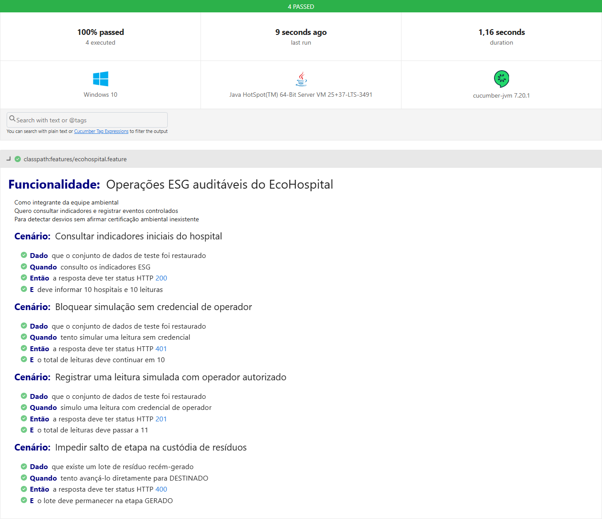
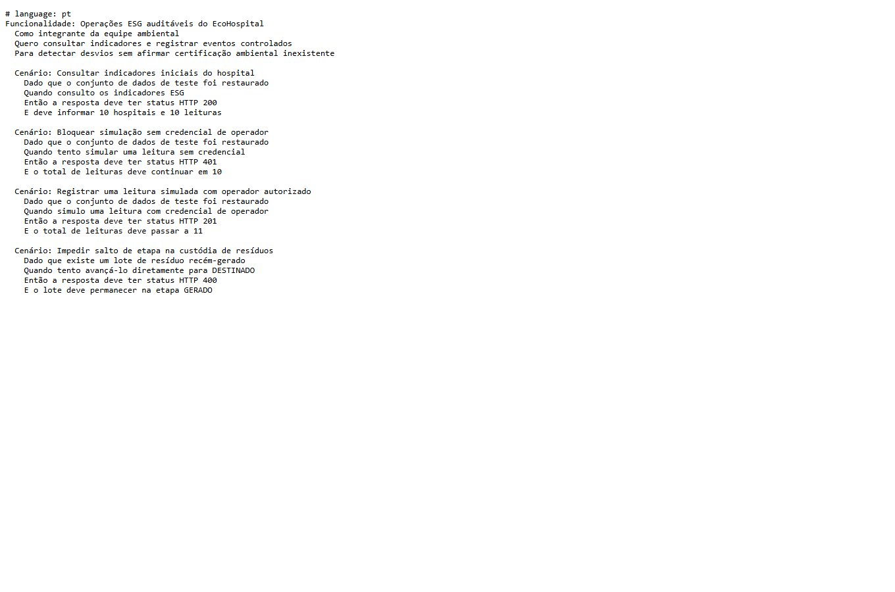

# EcoHospital Smart — atividade de Testes Automatizados

Aluno: Kalicon Amorim da Cruz Souza (RM 563172). Projeto ESG em Java 17 + Spring Boot 3.5.16. Esta entrega é **separada** da atividade anterior de CI/CD. Os dados são didáticos e não constituem certificação ambiental.

## Executar

Requisitos: JDK 17+ e acesso ao Maven Central na primeira execução. No Windows PowerShell, a partir da pasta do projeto:

```powershell
.\mvnw.cmd -B -ntp verify
python scripts/collect-test-evidence.py
```

Em Linux/macOS: `bash mvnw -B -ntp verify`. O Maven Wrapper baixa as dependências; não é preciso instalar Maven. Para executar no Docker: `docker build -t ecohospital-testes .` — o estágio de build do Dockerfile executa `mvn verify`. O workflow `.github/workflows/ci-cd.yml` também executa `mvnw verify` antes de criar imagem/deploy; uma falha bloqueia os jobs dependentes. Os testes não escrevem nos volumes reais de staging e produção: usam armazenamento de teste isolado e restauram o seed antes de cada caso.

Resultados gerados: `target/surefire-reports/TEST-*.xml`, `target/cucumber-report.html`, `target/cucumber-report.json` e `target/cucumber-junit.xml`. `scripts/collect-test-evidence.py` cria uma síntese verificável em `docs/testing/evidence/test-summary.json` e copia os relatórios Cucumber. Os PNG desta pasta foram capturados do relatório HTML real e do arquivo `.feature`, sem edição de resultados. Para reproduzir essas capturas, instale Playwright e Chromium/Edge e execute `node scripts/capture-test-evidence.cjs`; a execução dos testes **não depende** de Playwright.

## BDD — cenários Gherkin

Arquivo: `src/test/resources/features/ecohospital.feature`. A implementação está em `BddSteps.java`, configurada por `BddSpringConfig.java` e descoberta por `BddTest.java` no JUnit Platform.

| Cenário | Caminho | Resultado esperado |
|---|---|---|
| Consultar indicadores iniciais | positivo | HTTP 200, 10 hospitais e 10 leituras no JSON |
| Bloquear simulação sem credencial | negativo/segurança | HTTP 401 e nenhuma nova leitura |
| Registrar leitura com operador | positivo/escrita | HTTP 201 e 11 leituras |
| Impedir salto de custódia | negativo/integridade | HTTP 400 e lote permanece em `GERADO` |

Os tokens em `src/test/resources/users-bdd.json` são **fictícios e exclusivos dos testes**, não são credenciais de staging/produção.

## API e contratos JSON Schema

`ApiContractTest.java` testa todos os **21 mapeamentos REST declarados** nos três controllers e também `/actuator/health`. Para rotas parametrizadas, testa as cinco coleções originais e os dois tipos de registro (`inventory` e `waste`), inclusive criação/anulação. Cada resposta de sucesso é verificada por status HTTP, JSON decodificado, campos de negócio e um schema de `src/test/resources/api-contracts.json` (draft 2020-12, biblioteca NetworkNT). Há casos adicionais 400, 401, 403 e 404 com prova de que a rejeição não alterou as leituras. Respostas de erro do Spring são validadas por status e estado preservado; o framework não garante corpo JSON no `MockMvc` sem encaminhamento de erro.

| Grupo | Rotas testadas |
|---|---|
| Saúde/visão geral | `/health`, `/actuator/health`, `/api/status`, `/api/kpis`, `/api/insights`, `/api/operations`, `/api/test-runner` |
| Acesso | `/api/access/me`, escrita sem credencial, revisão com papel inadequado |
| Coleções/consultas | `/api/collections/{name}` (cinco nomes), `/api/query/preset` leitura e atualização |
| Telemetria | `/api/telemetria/simular`, `/api/reset` |
| Governança | `/api/actions` GET/POST, `/api/actions/{id}` PATCH |
| Inventário/fatores/resíduos | `/api/journal/{kind}` GET/POST, `/api/journal/factors` GET/POST, `/api/journal/factors/{id}/review`, `/api/journal/waste/{id}/advance`, `/api/journal/{kind}/{id}/void` |

Os contratos verificam tipos e obrigatoriedade de campos importantes; não pretendem provar conformidade ambiental externa. O contrato de lista valida o tipo array e, após criar dados, valida cada registro retornado. A suíte JUnit anterior também continua rodando.

## Evidências de 22/10/2026

O `mvnw.cmd -B -ntp verify` retornou `BUILD SUCCESS`, **50 testes, 0 falhas, 0 erros, 0 ignorados**: 43 JUnit preexistentes, 3 testes de contrato e 4 cenários BDD. Consulte os arquivos desta pasta e o PDF `docs/testing/EcoHospital_Testes_Automatizados.pdf`.





## Checklist da atividade

| Requisito | Status | Evidência |
|---|:---:|---|
| Projeto Java Spring ESG anterior reutilizado | OK | `src/main/java`, `pom.xml` |
| No mínimo 3 cenários BDD em Gherkin | OK | Quatro cenários em `ecohospital.feature` |
| Caminhos positivos e negativos | OK | HTTP 200/201 e 400/401 |
| Testes de todas as APIs, status e corpo JSON | OK | `ApiContractTest.java`, matriz acima |
| Contratos JSON Schema | OK | `api-contracts.json` e validação NetworkNT |
| Execução simples local ou CI | OK | `mvnw verify`, workflow existente |
| Código e instruções em ZIP | OK | Pacote desta atividade na pasta `delivery` |
| PDF com cenários, prints e resultados | OK | `docs/testing/EcoHospital_Testes_Automatizados.pdf` |

Limite: a evidência é de execução local. O CI executará a nova suíte quando estas mudanças forem enviadas ao repositório; **não se declara um run remoto desta revisão**. Esta atividade não exige novo deploy.

## Evolução de 26/10/2026 — sprint posterior

O texto e o PDF acima registram a entrega histórica de 22/10/2026 com 50 testes e quatro cenários; permanecem preservados. A suíte atual foi ampliada para **55 testes JUnit/Cucumber e seis cenários BDD**, com origem `DECLARED`/`SIMULATED` no inventário, rejeição de origem desconhecida e contratos JSON Schema mais estritos. O resumo do frontend tem teste Node independente que exclui simulações e anulações e mantém os dois métodos do escopo 2 separados. O comando `scripts/verify.ps1` retornou `BUILD SUCCESS` em 26/10/2026, e o build Docker com Java 17 executou a mesma suíte com sucesso. Capturas novas do relatório Cucumber e da UI isolada estão em `docs/evidence/sprint-2026-10-26/`. Esses arquivos não transformam os dados sintéticos em inventário oficial.
